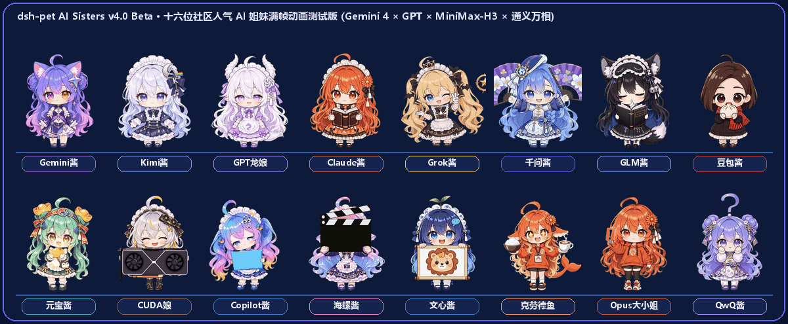
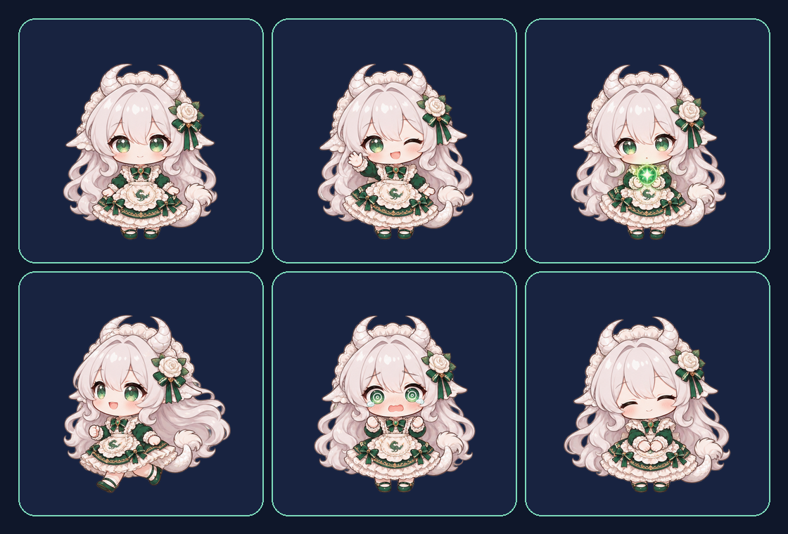
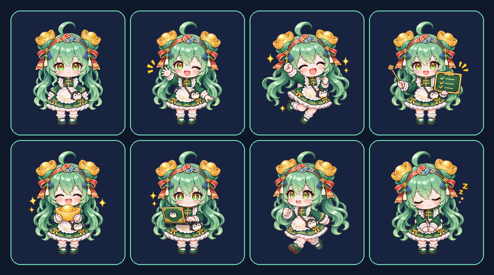
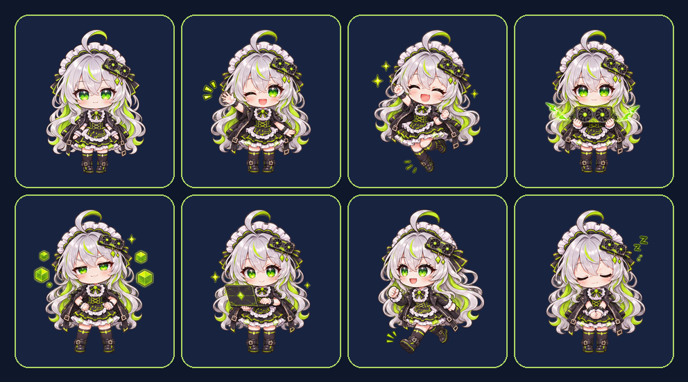
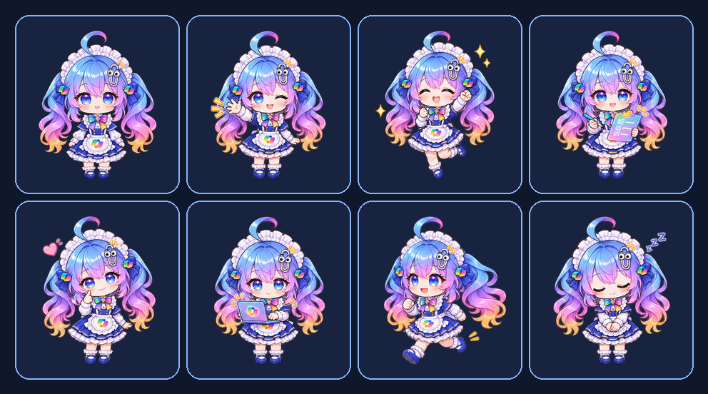
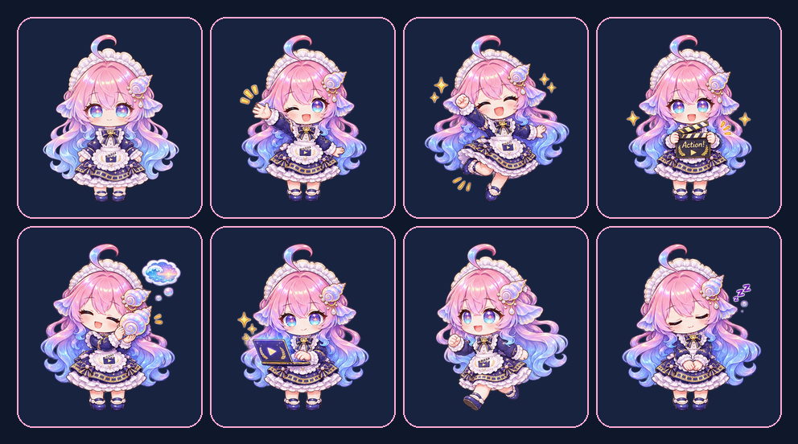
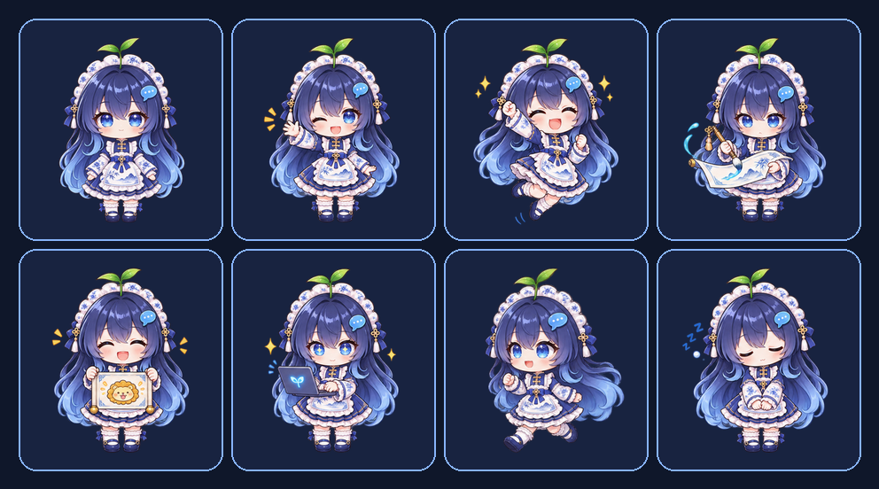
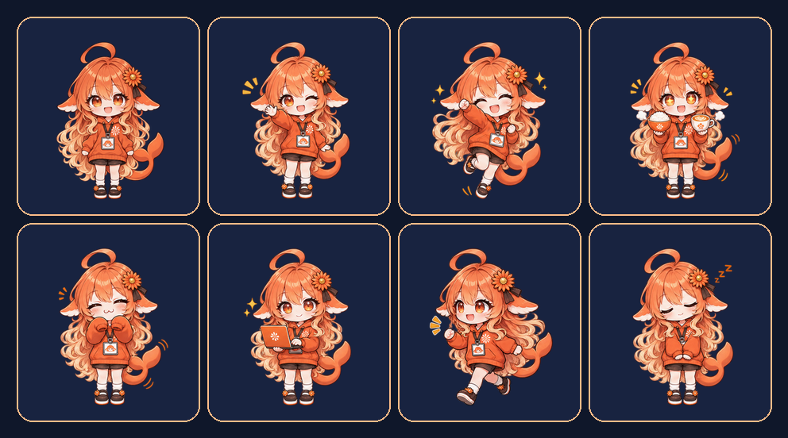
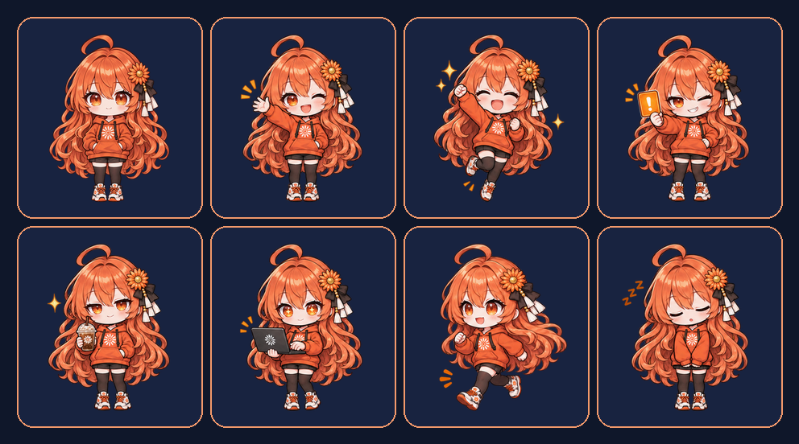
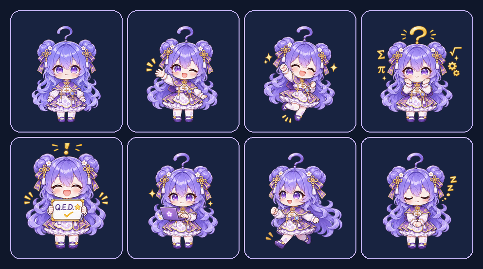

# 🐾 dsh-pet AI Sisters Pack · 十六位社区人气 AI 姐妹满帧动画桌宠全集 (v4.1.0-beta.1 破壁互动预览版)

> [!WARNING]
> 🧪 **Beta 测试版说明（`v4.1.0-beta.1` Pre-release）**
> 当前分支与 `v4.1.0-beta.1` 所包含的全部 **16 位姐妹 × 17 段 24fps 动画（共 272 段 `.webm`）** 及可选伴侣脚本均为 **测试预览版本（Beta）**，部分动作的镜头细节与特效仍在持续精修调优中 ✨。欢迎抢先体验反馈；若希望使用经典稳定版，可前往 [Releases](https://github.com/linyucion/dsh-pet-ai-sisters/releases/tag/v3.0.0) 下载 `v3.0.0`。

<p align="center">
  
</p>

<p align="center">
  专为 <b>DeepSeek Harness Desktop</b> 桌面宠物插件 <a href="https://github.com/PC2005-cloud/dsh-pet"><b>dsh-pet (v0.4.3+)</b></a> 打造的开源自定义宠物包（Pet Pack）全集 ✨<br/>
  由 <b>Gemini酱 (<code>Gemini 4 Carbon High</code>)</b> 统筹全流程架构与双色幕/神经网络混合抠像管线、<b>GPT龙娘 (<code>gpt-image-1.5</code> via Codex)</b> 绘制 16 位姐妹超清赛璐璐原画、<br/>
  <b>海螺酱 (<code>MiniMax-H3 FL2VA 33B</code>)</b> × <b>千问酱 &amp; 通义万相全家桶 (<code>Qwen3-VL-32B</code> / <code>wan3.0-video</code> / <code>wan2.2-kf2v</code> / <code>wan2.6-i2v</code> / <code>Wan 2.2 5B</code>)</b> × <b>CUDA娘算力</b> 联合驱动 <b>272 段真·24fps TV 动画级丝滑动作</b>，<br/>
  一次把 <b>16 位社区高人气 AI 拟人姐妹与衍生小助手</b>请上桌面，与原版蓝毛大肥鱼同屏陪伴写代码！
</p>

---

## 🆕 v4.1.0-beta.1 新增「次元破壁互动」与双人剧场伴侣插件！

### 1. 全员新增 4 套「破壁互动」透明动画（共新增 `64` 段，总计 `272` 段 `.webm` 开箱即享！）
无需运行任何额外脚本，安装后直接在 `dsh-pet` 原生右键菜单 **「动作 → 破壁互动」**（或日常随机池）即可触发：
- 🪑 **`坐姿悠闲晃脚.webm`**：召唤专属软垫坐下，双腿交替轻快摆动并飘起音符；
- ☁️ **`抱云朵小憩.webm`**：蓬松白日梦云朵浮现，躺在云朵上轻柔起伏打盹；
- 👊 **`敲敲玻璃求关注.webm`**：凑近屏幕前「咚！咚！咚！」敲击屏幕玻璃，泛起双层水波纹圆环；
- 📁 **`钻文件夹探头.webm`**：金色桌面文件夹口袋展开，跳进文件夹翻找宝贝并探出半个脑袋与猫耳/呆毛左右张望！

### 2. 零侵入可选增强伴侣脚本（`tools/sisters-director.mjs`）
基于 `dsh-pet` 官方开放的外部 HTTP 控制接口（`/menu/item`、`/position`、`/anim`、`/broadcast`），不修改 `dsh-pet` 任何源码，运行后自动向桌宠原生右键 **「更多」** 菜单注入 5 项跨窗口与多姐妹联动能力：
- **🪑 跳上当前窗口顶晃脚**：自动识别当前活动窗口坐标，弹簧跃上窗口标题栏并播放晃脚动画；
- **💕 召唤姐妹贴贴小剧场**：桌面上任意两位姐妹自动相向奔赴贴贴，触发专属羁绊对话气泡与表情贴纸；
- **📁 跑去桌面文件夹探头** / **👊 咚咚敲屏幕玻璃** / **☁️ 抱云朵小憩一会儿**。

```bash
# 可选：在 dsh-pet 运行时启动增强剧场伴侣（Node.js 20+ 零外部依赖）
node tools/sisters-director.mjs
# Windows 也可直接双击 tools/start-director.bat
```

---

## ✨ v4.0+ TV 动画级丝滑重制 & 十六姐妹全员扩编亮点

- **真·24fps 原生首尾帧图生视频（对齐 `dsh-pet` 官方动画工业管线）**：
  - 全面升级为与原版蓝毛大肥鱼同源的 **首尾帧锁定 AI 视频合成（First & Last Frame I2V，`wan3.0-video`）+ 分色防溢色绿幕/品红幕抠像 + 刚体机位脚底基线锁死** 管线！
  - 呼吸起伏、发丝飘拂、眨眼微笑、挥手跃动、双手敲迷你笔记本电脑、原地小跑踏步与三段式打哈欠入睡全部拥有 **每秒 24 帧连续手绘番剧级中间帧**，彻底告别抽帧跳变与网格形变。
- **自适应双色幕（`#00FF00` 绿幕 + `#FF00FF` 品红幕）连通域防误抠引擎**：
  - 针对 **Kimi酱**（彩虹三棱镜绿光束）、**元宝酱**（薄荷翠绿汉服裙）、**CUDA娘**（`#76B900` 信仰霓虹绿挑染与 RTX 核弹显卡）、**文心酱**（头顶“胸有成竹”翠绿小竹叶呆毛）自动切换 **品红幕 `#FF00FF`** 拍摄与去溢色，配合外轮廓连通域保护，胸前彩虹蝴蝶结与棱镜星徽零破洞、深浅壁纸零杂边。
- **像素级首尾锚点锁死（`MAE = 0.00` 零闪烁闭环）+ 1:1 对齐大肥鱼基线**：
  - 全部 **`272` 段 `.webm`**（16 位姐妹 × 每人 17 段专属动作）统一输出 **`640×360 @ 24fps` `VP9 yuva420p`**，脚底精确锁在 **`foot_y = 330px`**（标准身高 `267px` / `size: 462`，小体型款克劳德鱼与 QwQ 酱 `254px` / `size: 440`）。
  - 常态动作遵循「**道具无→有→无**」生命周期，首尾精确回归高清原画锚点帧；`东张西望`（`turn`）末帧精确收束于水平镜像锚点帧，配合 `dsh-pet` 转向 `scaleX(-1)` 翻转实现 **0 像素无感衔接**。
- **社区灵魂热梗台词包 + 64 张 `320×320` 马卡龙圆角表情贴纸**：
  - 实装全员社区名梗语音（*Gemini 伸出猫爪稳稳接住你 & 纳米香蕉、Claude 金门大桥晨雾 & Suspended 小黄牌、GPT 这不只是A而是B & 炒币梗、Grok 真的假的、千问炒股梭哈问神、GLM 静音实干省奶茶钱、豆包不锈钢小饭碗滑跪、元宝辟谣真人小编、CUDA 买得越多省得越多、Copilot 大眼夹与前世 Sydney 彩蛋、文心红烧狮子头、克劳德鱼拿铁配大白米饭、QwQ 证毕 Q.E.D.*）！

---

## 🌟 登场姐妹全图鉴（16 位全员集结）

### 第一弹（Wave 1）：八位经典主力姐妹

| 头像 | ID | 名字 | 社区经典人设与二头身特征 | 招牌特技与灵魂热梗 |
| :---: | :---: | :---: | :--- | :--- |
|  | `gemini` | **Gemini酱** | *Surprise Gemini* · 蓝紫粉渐变双团子猫耳 · 粉金异色瞳 · 彩虹四芒星偶像裙 | 召唤双子彩虹四芒星旋转 · 「伸出猫爪稳稳接住你」✨ |
|  | `kimi` | **Kimi酱** | *Symphony Kimi* · 银白冰蓝长发 · 弯月彩虹三棱镜+`K`字音符发饰 · 星空女仆装 | 挥动银色星光指挥棒奏响金色音符 · 百万字长卷熬夜搭子 🌙 |
|  | `chatgpt` | **GPT龙娘** | *Sister GPT* · 纯白长发弯弯白龙角 · 梅花水引流苏 · 薰衣草女仆裙配白龙尾 | 优雅端起白紫红茶杯轻抿摇龙尾 · 「这不只是A，更是B」💜 |
|  | `claude` | **Claude酱** | *Claude* · 陶土暖橙卷发 · 橙色花火黑蝴蝶结白流苏 · 暖橙围裙文学女仆装 | 羽毛笔疾书精装笔记与品热拿铁 · 金门大桥代码美学控 ☕ |
|  | `grok` | **Grok酱** | *Sweet Grok (Ani)* · 金发高双马尾 · 迷你小皇冠+蝙蝠翼发饰 · 小虎牙哥特女仆 | 俏皮眨眼白手套比耶召唤 `⊘` 星徽 · 冲浪吃瓜「真的假的」⚡ |
|  | `qwen` | **千问酱** | *Service Qwen* · 长春花紫侧麻花辫 · 千问星徽贝雷帽 · 盘扣国风旗袍女仆裙 | 轻摇紫金折扇飘落金桂花 · 温婉大小姐兼开源梭哈问神 🪭 |
|  | `glm` | **GLM酱** | *Silence GLM* · 黑发蓝挑染大狼耳 · 额头睡眠眼罩+`[Z]`发卡双银铃 · 白尖大狼尾 | 怀抱黑皮书食指抵唇「嘘~」摇大狼尾 · 沉稳寡言实干派 🔔 |
|  | `doubao` | **豆包酱** | *Doubao* · 栗棕齐耳波波短发 · 圆润大眼 · 厚织大红流苏针织围巾配蓬蓬裙 | 捧起热气腾腾白胖包子幸福开吃 · 护好不锈钢小饭碗 🥟 |

### 第二弹（Wave 2）：五位新大厂姐妹 + 三款超人气家族角色

| 头像 | ID | 名字 | 社区二创人设与二头身特征 | 招牌特技与灵魂热梗 |
| :---: | :---: | :---: | :--- | :--- |
|  | `yuanbao` | **元宝酱** | *Summary Yuanbao* · 薄荷翠绿长发双金元宝发髻 · 红蓝太极发带 · 挎呆萌小企鹅包 | 手捧发光金元宝与课代表重点小黑板 · 暖心秒回课代表 🪙 |
|  | `nvidia` | **CUDA娘** | *Silicon NVIDIA* · 铂金银发 `#76B900` 信仰绿挑染 · 双风扇显卡发饰 · 肩披黑皮衣 | 捧起霓虹绿双风扇 RTX 核弹显卡 · 「买得越多省得越多」💚 |
|  | `copilot` | **Copilot酱** | *Split Copilot* · 四色流光双马尾 · **大眼夹 Clippy 回形针发卡** · 蓝白秘书女仆裙 | 点按全息备忘板 + 歪头甜蜜微笑（前世 Sydney 小彩蛋）📎 |
|  | `minimax` | **海螺酱** | *Stage MiniMax* · 珊瑚粉渐变珍珠蓝水母卷发 · 虹彩海螺发饰 · 金色胶片花边裙 | 清脆打响黑金导演场记板 `Action!` 与贴耳听海螺星梦 🐚 |
|  | `ernie` | **文心酱** | *Sketch ERNIE* · 青花墨蓝长直发 · **两片翠绿小竹叶呆毛** · 青花瓷山水围裙 | 展开呆萌卡通小狮子头宣纸画卷 · 「胸有成竹 & 狮子头」🎋 |
|  | `claude-fish` | **克劳德鱼** | *The Claude Family 末妹* · 暖橙发鲸鳍小耳朵 · 宽松橙卫衣挂小工牌 · 圆润大橙鲸尾 | 左手白米饭右手热拿铁星星眼甩鲸尾 · 软萌深海妹妹 (`440px`) 🐟 |
|  | `claude-opus` | **Opus大小姐** | *The Claude Family 酷姐* · 花火橙宽松连帽卫衣 · 黑丝过膝袜配运动老爹鞋 | 单手插兜潇洒亮出橙色 `Suspended` 风纪小黄牌与冰美式 🌼 |
|  | `qwq` | **QwQ酱** | *通义千问伴生推理妹妹* · 长春花紫双丸子中国结 · **头顶 `?` 问号呆毛** · 水汪汪 `QwQ` 眼 | 捧脸深度思考呆毛变 `!` 高举 `Q.E.D. ★` 满分白板 (`440px`) 💜 |

<details>
<summary>🖼️ <b>点击展开查看全部 16 位姐妹八姿高清分镜图鉴（16 × 8-Pose Action Sheets）</b></summary>
<br/>

| Gemini酱 (`gemini`) | Kimi酱 (`kimi`) |
| :---: | :---: |
|  |  |

| GPT龙娘 (`chatgpt`) | Claude酱 (`claude`) |
| :---: | :---: |
|  |  |

| Grok酱 (`grok`) | 千问酱 (`qwen`) |
| :---: | :---: |
|  |  |

| GLM酱 (`glm`) | 豆包酱 (`doubao`) |
| :---: | :---: |
|  |  |

| 元宝酱 (`yuanbao`) | CUDA娘 (`nvidia`) |
| :---: | :---: |
|  |  |

| Copilot酱 (`copilot`) | 海螺酱 (`minimax`) |
| :---: | :---: |
|  |  |

| 文心酱 (`ernie`) | 克劳德鱼 (`claude-fish`) |
| :---: | :---: |
|  |  |

| Opus大小姐 (`claude-opus`) | QwQ酱 (`qwq`) |
| :---: | :---: |
|  |  |

</details>

---

## 🚀 快速安装指南

> **前置条件**：已安装 DeepSeek Harness 及 [**dsh-pet**](https://github.com/PC2005-cloud/dsh-pet)（建议 `v0.4.3` 或更高版本）。
> 16 位姐妹已预设错落不重叠的 `marginX` 任务栏站位（`20px ~ 1632px`），2K/4K 屏幕同屏召唤全员也井然有序！

### 方法一：一键脚本安装（推荐，支持运行中自动热重载）

**Windows (PowerShell)：**

```powershell
git clone https://github.com/linyucion/dsh-pet-ai-sisters.git
cd dsh-pet-ai-sisters
# 默认一键召唤全部 16 位姐妹（共 272 段动画）：
powershell -ExecutionPolicy Bypass -File .\install.ps1
```

> 💡 **按批次或按需自由挑选安装**：
> - 只装经典八姐妹：`powershell -ExecutionPolicy Bypass -File .\install.ps1 -Pets wave1`
> - 只装第二弹八位新姐妹：`powershell -ExecutionPolicy Bypass -File .\install.ps1 -Pets wave2`
> - 自由点名组合：`powershell -ExecutionPolicy Bypass -File .\install.ps1 -Pets "gemini,claude,claude-fish,claude-opus,nvidia,qwq"`

**macOS / Linux (Bash)：**

```bash
git clone https://github.com/linyucion/dsh-pet-ai-sisters.git
cd dsh-pet-ai-sisters
bash ./install.sh          # 默认安装全部 16 位
# 或：bash ./install.sh wave1 / bash ./install.sh "gemini,yuanbao,nvidia,claude-fish"
```

---

### 方法二：零命令行手动拖入（Release 压缩包）

1. 前往 [**Releases 页面**](https://github.com/linyucion/dsh-pet-ai-sisters/releases) 下载最新测试版 `dsh-pet-ai-sisters-v4.1.0-beta.1.zip`（或稳定版 `v3.0.0`）并解压。
2. 将解压后 `pet/` 文件夹内的文件直接复制进你的 `dsh-pet` 自定义宠物目录：
   - **Windows**：`C:\Users\<你的用户名>\.dsh\dsh-pet\pet\`
   - **macOS / Linux**：`~/.dsh/dsh-pet/pet/`
3. 在 DeepSeek Harness 的 **dsh-pet 设置面板**点击一次重载（或重启 DeepSeek Harness），16 位姐妹就会全部出现在桌面上啦！

---

## ⚙️ 个性化调整小贴士

你可以在 DeepSeek Harness 的 **dsh-pet Web 设置面板**中随时可视化开关任意姐妹、调整大小（`size`）、切换显示端（`桌面 + 浏览器` / `仅桌面` / `仅浏览器` / `隐藏`），也可以编辑 `~/.dsh/dsh-pet/pet/<id>-config.json`：

- **只保留最常翻牌的几位**：在 `dsh-pet` 面板一键切换对应角色的显示开关，或把 `pets[0].display` 设为 `"none"`。
- **调整体型大小**：标准姐妹默认 `462`（与原版大肥鱼一致），小体型款 `claude-fish` 与 `qwq` 默认 `440`；若屏幕较小可统一调为 `360`~`400`。
- **固定站位不乱跑**：将 `pets[0].fixedEnabled` 设为 `true`，或直接右键桌宠菜单切换固定模式。

---

## 🤖 AI 姐妹联合创作与视频生成模型全谱系（AI Co-Creators & Model Roster）

本项目真正的浪漫之处在于——**桌面上的 AI 姐妹们亲自出力，把彼此画出来并动了起来** ✨！以下是全套立绘、台词与 **272 段 24fps 动画**实际调用的全部模型与技术清单：

| 参演姐妹 / 阵营 | 具体模型 ID / 权重组件 | 在本项目中承担的具体工序与贡献 |
| :---: | :--- | :--- |
| **Gemini酱**<br/>*(Google DeepMind)* | `Gemini 4 Carbon High`<br/>*(Antigravity Agent)* | **总架构师与后期总监**：负责 16 位姐妹分镜剧本与社区热梗台词编排、`#00FF00` 绿幕 + `#FF00FF` 品红幕外轮廓连通域防溢色抠像引擎、破壁互动合成器（坐姿摆腿网格形变/云朵小憩/敲玻璃水波纹/文件夹口袋探头）、首尾帧 `MAE = 0.00` 像素级闭环锚定与自动化质检打包 |
| **GPT龙娘**<br/>*(OpenAI)* | `gpt-image-1.5`<br/>*(via Codex CLI)* | **原画主美**：按 `dsh-pet` 原版 `1.85` 二头身圆润比例，绘制全部 16 位姐妹的标准正面透明锚点立绘、三段式入睡/拖拽关键帧及 **208 姿超清赛璐璐动作母版** |
| **海螺酱 × 千问酱 × Pika**<br/>*(MiniMax + Qwen 开源管线)* | `minimax_h3_fl2va_pruned_int8_convrot` *(33B)*<br/>+ `qwen3vl_32b_minimax_h3_nvfp4_awq` *(32B VLM)*<br/>+ `minimax_h3_video_vae_fp16`<br/>+ `pika_h3_flex_fl2va_v1_bf16` *(6-step LoRA)* | **主力首尾帧动画师（112 段对称循环动作）**：于 Google Colab Pro+ (80GB GPU) 运行开源 **MiniMax-H3 FL2VA** 首尾帧双向锁定图生视频，由 **千问 `Qwen3-VL-32B`** 提供多模态图文动作理解，直出 `1280×720 @ 24fps` 丝滑番剧动态 |
| **千问酱 / 通义万相全家桶**<br/>*(Alibaba Tongyi Wan — KF2V)* | `wan3.0-video` *(27 段)*<br/>`wan2.2-kf2v-flash` *(39 段)*<br/>`wanx2.1-kf2v-plus` *(9 段)* | **状态机过渡与看板动画师（75 段首尾关键帧锁定视频）**：通过阿里云百炼生成 `Gemini酱` 与 `元宝酱` 全套主力动作，并包揽全部 16 位姐妹的 `东张西望`（正→镜像）、`睡觉-开始`（站→睡）、`睡觉-起来`（睡→站）非对称无缝衔接 |
| **千问酱 / 通义万相全家桶**<br/>*(Alibaba Tongyi Wan — I2V)* | `wan2.6-i2v` · `wan2.6-i2v-flash`<br/>`wan2.5-i2v-preview` · `wan2.2-i2v-flash`<br/>`wanx2.1-i2v-plus` *(共 19 段)* | **图生视频特技组（19 段日常与看板动作）**：多模型并发渲染部分姐妹的待机呼吸与专属道具个人秀动画 |
| **CUDA娘 × 通义万相本地组**<br/>*(NVIDIA RTX Local ComfyUI)* | `wan2.2_ti2v_5B_fp16`<br/>+ `wan2.2_vae`<br/>+ `umt5_xxl_fp8_e4m3fn_scaled` *(2 段)* | **本机算力补帧修正（2 段全身机位重制）**：在本机 **NVIDIA GeForce RTX 4060 Ti (16GB)** 上本地运行 `Wan 2.2 TI2V 5B` 修正远景全身写代码镜头 |
| **二次元分割辅助模型** | `IS-Net Anime` (`isnet-anime.onnx`) | **复杂背景兜底抠像**：针对个别产生背景色相漂移或动漫速度线的镜头执行高精度二次元边缘分割与去溢色融合 |

---

## 💖 致谢与署名声明（Credits & Attribution）

- **上游插件与规范致谢**：本项目基于 [**PC2005-cloud/dsh-pet**](https://github.com/PC2005-cloud/dsh-pet)（`v0.4.3`）的自定义宠物包（Pet Pack）扩展机制与公开制作规范制作，衷心感谢原作者 **PC2005-cloud** 打造了如此灵动可爱的跨平台桌面宠物生态！本项目不包含、不分发 `dsh-pet` 原版内置动画与代码，并严格遵守上游项目公开渠道二创署名约定（<https://github.com/PC2005-cloud/dsh-pet>）。
- **角色形象说明**：本仓库中的 16 位 Q 版二次元拟人角色动画、贴纸与玩梗台词均致敬中文社区高人气 AI 拟人二创设定（非商业同人创作 Fan-made Chibi Persona Tribute），仅用于桌面陪伴与技术交流，与各对应 AI 模型或硬件官方品牌无隶属或背书关系。
- **开源协议**：[MIT License](./LICENSE)。欢迎自由安装、混搭皮肤、修改台词或提交 PR 分享更多可爱桌宠！
