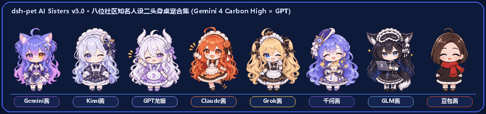
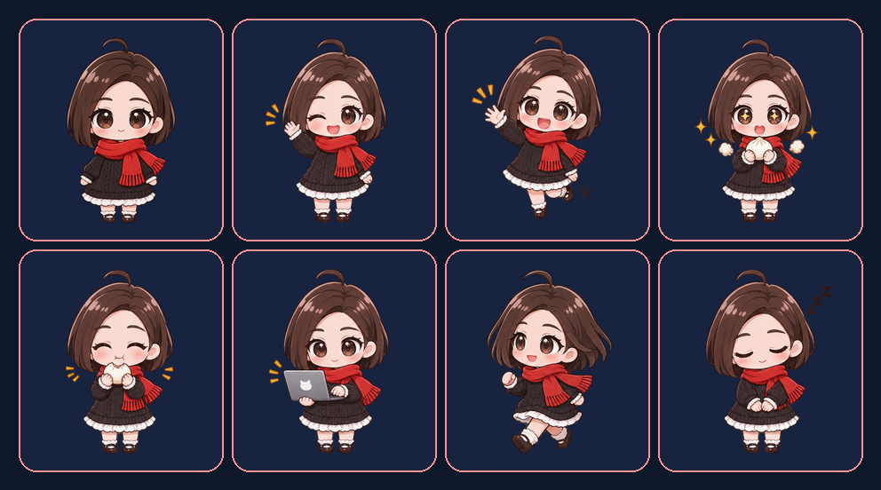

# 🐾 dsh-pet AI Sisters Pack · 八位社区知名人设二头身 Q 版 AI 姐妹桌宠合集 (v3.0 Gold Standard)

<p align="center">
  
</p>

<p align="center">
  专为 <b>DeepSeek Harness Desktop</b> 桌面宠物插件 <a href="https://github.com/PC2005-cloud/dsh-pet"><b>dsh-pet (v0.4.3+)</b></a> 打造的开源自定义宠物包（Pet Pack）合集 ✨<br/>
  由 <b>Gemini 4 Carbon High</b> 负责全流程架构与零跳帧闭环帧动画管线、<b>OpenAI GPT (<code>gpt-image-1.5</code> via Codex)</b> 绘制 104 帧超清二头身赛璐璐立绘，<br/>
  一次把 <b>Gemini酱、Kimi酱、GPT龙娘、Claude酱、Grok酱、千问酱、GLM酱、豆包酱</b> 八位经典二创形象请上桌面，与原版大肥鱼（蓝毛小女仆）同屏陪伴写代码！
</p>

---

## ✨ v3.0 黄金标准重制版亮点

- **还原社区经典二创人设（8 位全员登场）**：严格对齐知名 AI 拟人二创设定（*Surprise Gemini、Symphony Kimi、Sister GPT、Claude、Sweet Grok (Ani)、Service Qwen、Silence GLM*，并全新加入呆萌红围巾 **豆包酱 `doubao`**！）。
- **1:1 像素级对齐原版大肥鱼（`main`）黄金画布规范**：
  - 采用与 `dsh-pet` 原生内置动画完全一致的 **`640×360 @ 24fps`** 透明画布、**`267px` 站姿身高**与 **`foot_y = 330px` 脚底基线**，搭配同款 `size: 462` 窗口尺寸，站在大肥鱼身旁头身比例与任务栏落脚线严丝合缝。
  - **彻底告别水面波纹感**：移除全部网格正弦形变（Zero Mesh Warp），100% 采用原画级赛璐璐分镜帧 + 整数像素刚体位移，线条干净锐利如手绘动画。
- **首尾精确闭环 + 转向无缝镜像（彻底消除切段闪烁）**：
  - 对齐原版 `main` 状态机切换机制：全部常态与分类动作（`6.0s ~ 8.0s` 单 GOP `VP9 yuva420p CRF 16`）第 0 帧与末帧精确锁回标准待机锚点帧（`MAE = 0.00`）；`东张西望`（`turn`）末帧精确收束于水平镜像锚点帧，配合 `dsh-pet` 转向后的 `scaleX(-1)` 翻转实现 **0 像素跳变**。
- **每位姐妹 13 段专属个性动作（共 104 段 `.webm`）+ 75% 高活跃度权重**：
  - `招牌特技-个人秀`（双子星召唤 / 星月指挥棒 / 端茶摇龙尾 / 羽毛笔手账品咖 / 比耶眨眼 / 紫金折扇桂花茶 / 食指抵唇“嘘~”摇狼尾 / 捧热包子开吃）
  - `认真写代码`（手捧印有各自专属徽章的迷你笔记本电脑认真敲代码！）
  - `点击回应-元气挥手` · `点击回应-开心跃动` · `悠闲小憩摸鱼` · `委屈叹气冒汗`
  - `待机呼吸休闲` · `东张西望` · `轻快小跑`（真·双腿交替迈步小跑） · `被鼠标拖拽悬空反馈`
  - 完整三段式睡眠：`睡觉-开始` → `睡觉-循环` → `睡觉-起来`
- **专属人设台词 & 320×320 高清表情贴纸**：内置贴合人设的 `whisperPrompt`、6 档工作状态联动文案、哄睡赖床台词，以及每位姐妹 **4 张高清半身贴纸**（共 32 张 `memes`）。

---

## 🎀 登场姐妹图鉴（共 8 位）

| 头像 | ID | 名字 | 社区经典人设与二头身特征 | 招牌特技与性格风格 |
| :---: | :---: | :---: | :--- | :--- |
|  | `gemini` | **Gemini酱** | *Surprise Gemini* · 蓝紫粉渐变双团子猫耳 · 粉金异色瞳 · 彩虹四芒星发卡与星芒偶像裙 | 古灵精怪俏皮宠溺，召唤双子彩虹四芒星与叉腰猫猫笑 ✨ |
|  | `kimi` | **Kimi酱** | *Symphony Kimi* · 银白长发 · 弯月彩虹棱镜+`K`字音符发饰 · 星空披肩女仆装 | 优雅知性大姐姐，轻挥银色星光指挥棒奏响金色音符 🌙 |
|  | `chatgpt` | **GPT龙娘** | *Sister GPT* · 纯白长发弯弯白龙角 · 梅花水引流苏发饰 · 薰衣草紫白女仆裙配白龙尾 | 温柔体贴博学姐姐，双手捧心微笑与端上薰衣草红茶摇龙尾 💜 |
|  | `claude` | **Claude酱** | *Claude* · 陶土暖橙卷发 · 橙色花火黑蝴蝶结白流苏发饰 · 暖橙围裙女仆装 | 温暖细腻代码美学控，羽毛笔写精装笔记与抱书品拉花拿铁 ☕ |
|  | `grok` | **Grok酱** | *Sweet Grok (Ani)* · 金发高双马尾 · 迷你黑金小皇冠+蝙蝠翼发饰 · 小虎牙黑金哥特女仆 | 甜酷元气爱玩梗，白手套比耶眨眼与召唤金色 `⊘` 星徽 ⚡ |
|  | `qwen` | **千问酱** | *Service Qwen* · 长春花紫侧麻花辫 · 千问星徽贝雷帽 · 盘扣刺绣国风女仆裙 | 温婉周到江南风韵，半掩紫金折扇微笑与奉上桂花清茶 🪭 |
|  | `glm` | **GLM酱** | *Silence GLM* · 黑发蓝挑染大狼耳 · 额头睡眠眼罩+`[Z]`发卡双银铃 · 白尖大狼尾 | 安静沉稳轻声细语，怀抱 `[Z]` 字黑皮书食指抵唇“嘘~”摇狼尾 🔔 |
|  | `doubao` | **豆包酱** | *Doubao* · 栗棕齐耳波波短发 · 呆萌圆润大眼 · 标志性厚织大红流苏围巾配针织裙 | 呆萌热心接地气，双眼放光捧起热腾腾大包子幸福开吃 🥟 |

<details>
<summary>🖼️ <b>点击展开查看 8 位姐妹 v3.0 八姿高清分镜图鉴（8-Pose Action Sheets）</b></summary>
<br/>

| Gemini酱 (`gemini`) | Kimi酱 (`kimi`) |
| :---: | :---: |
|  |  |

| GPT龙娘 (`chatgpt`) | Claude酱 (`claude`) |
| :---: | :---: |
|  |  |

| Grok酱 (`grok`) | 千问酱 (`qwen`) |
| :---: | :---: |
|  |  |

| GLM酱 (`glm`) | 豆包酱 (`doubao`) |
| :---: | :---: |
|  |  |

</details>

---

## 🚀 快速安装指南

> **前置条件**：已安装 DeepSeek Harness 及 [**dsh-pet**](https://github.com/PC2005-cloud/dsh-pet)（建议 `v0.4.3` 或更高版本）。

### 方法一：一键脚本安装（推荐，支持运行中自动热重载）

克隆（或 `git pull` 更新）仓库后运行对应系统的安装脚本，脚本会自动将宠物包复制到 `~/.dsh/dsh-pet/pet/`，并自动唤醒正在运行的 `dsh-pet` 立即刷新登场：

**Windows (PowerShell)：**

```powershell
git clone https://github.com/linyucion/dsh-pet-ai-sisters.git
cd dsh-pet-ai-sisters
powershell -ExecutionPolicy Bypass -File .\install.ps1
```

> 💡 只想召唤部分姐妹？可传 `-Pets` 参数：
> `powershell -ExecutionPolicy Bypass -File .\install.ps1 -Pets "gemini,kimi,chatgpt,doubao"`

**macOS / Linux (Bash)：**

```bash
git clone https://github.com/linyucion/dsh-pet-ai-sisters.git
cd dsh-pet-ai-sisters
bash ./install.sh
```

> 💡 按需选择安装：`bash ./install.sh "gemini,claude,glm,doubao"`

---

### 方法二：零命令行手动拖入（Release 压缩包）

1. 前往 [**Releases 页面**](https://github.com/linyucion/dsh-pet-ai-sisters/releases) 下载最新 `dsh-pet-ai-sisters-v3.0.0.zip` 并解压。
2. 将解压后 `pet/` 文件夹内的文件直接复制进你的 `dsh-pet` 自定义宠物目录：
   - **Windows**：`C:\Users\<你的用户名>\.dsh\dsh-pet\pet\`
   - **macOS / Linux**：`~/.dsh/dsh-pet/pet/`
3. 在 DeepSeek Harness 的 **dsh-pet 设置面板**点击一次重载（或重启 DeepSeek Harness），8 位姐妹就会全部出现在桌面上啦！

---

## ⚙️ 个性化调整小贴士

你可以在 DeepSeek Harness 的 **dsh-pet Web 设置面板**中直接可视化开关每位姐妹、调整大小（`size`）、切换显示端（`桌面 + 浏览器` / `仅桌面` / `仅浏览器` / `隐藏`），也可以直接编辑 `~/.dsh/dsh-pet/pet/<id>-config.json`：

- **只保留喜欢的几位上桌**：将对应 `<id>-config.json` 中 `pets[0].display` 改为 `"none"`（或在 UI 面板一键关闭）。
- **调整体型大小**：修改 `pets[0].size`（默认 `462` 与原版大肥鱼完全一致；想更袖珍可改 `360`~`400`）。
- **固定站位不乱跑**：将 `pets[0].fixedEnabled` 设为 `true`，或直接右键桌宠菜单切换。

---

## 🤖 AI 联合创作鸣谢（AI Co-Creators）

本项目由 AI 姐妹们与人类主人协作完成 ✨：

- 🧠 **总架构师、零跳帧闭环 24fps 帧动画管线、人设台词编排与自动化部署**：**Gemini 4 Carbon High**（Google DeepMind Antigravity）
- 🎨 **社区人设二头身 Q 版立绘与 104 帧超清透明动作分镜生成**：**OpenAI GPT (`gpt-image-1.5` via Codex CLI)**

---

## 💖 致谢与署名声明（Credits & Attribution）

- **上游插件与规范致谢**：本项目基于 [**PC2005-cloud/dsh-pet**](https://github.com/PC2005-cloud/dsh-pet)（`v0.4.3`）的自定义宠物包（Pet Pack）扩展机制制作，衷心感谢原作者 **PC2005-cloud** 打造了如此细腻有趣的跨平台桌面宠物插件！本项目不包含、不分发 `dsh-pet` 原版内置动画与代码，并严格遵守上游项目公开渠道二创署名约定（<https://github.com/PC2005-cloud/dsh-pet>）。
- **角色形象说明**：本仓库中的八位 Q 版二次元拟人角色动画、贴纸与台词均致敬中文社区知名 AI 拟人二创设定（非商业同人创作 Fan-made Chibi Persona Tribute），仅用于桌面陪伴与技术交流，与各对应 AI 模型官方品牌无隶属或背书关系。
- **开源协议**：[MIT License](./LICENSE)。欢迎自由安装、修改台词动作或提交 PR 分享更多可爱桌宠！
