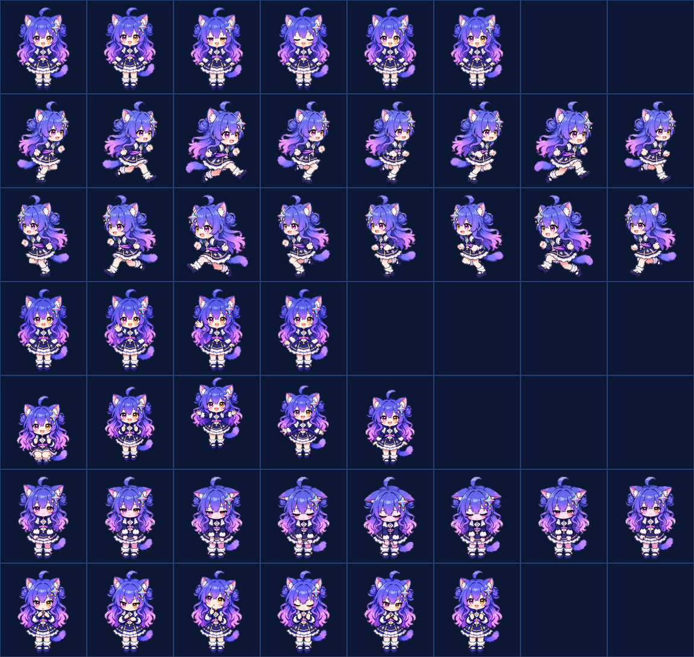
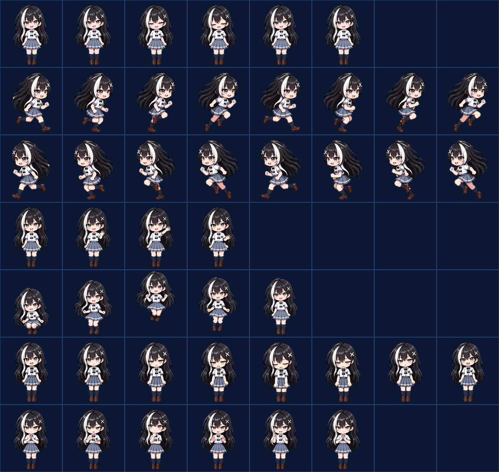
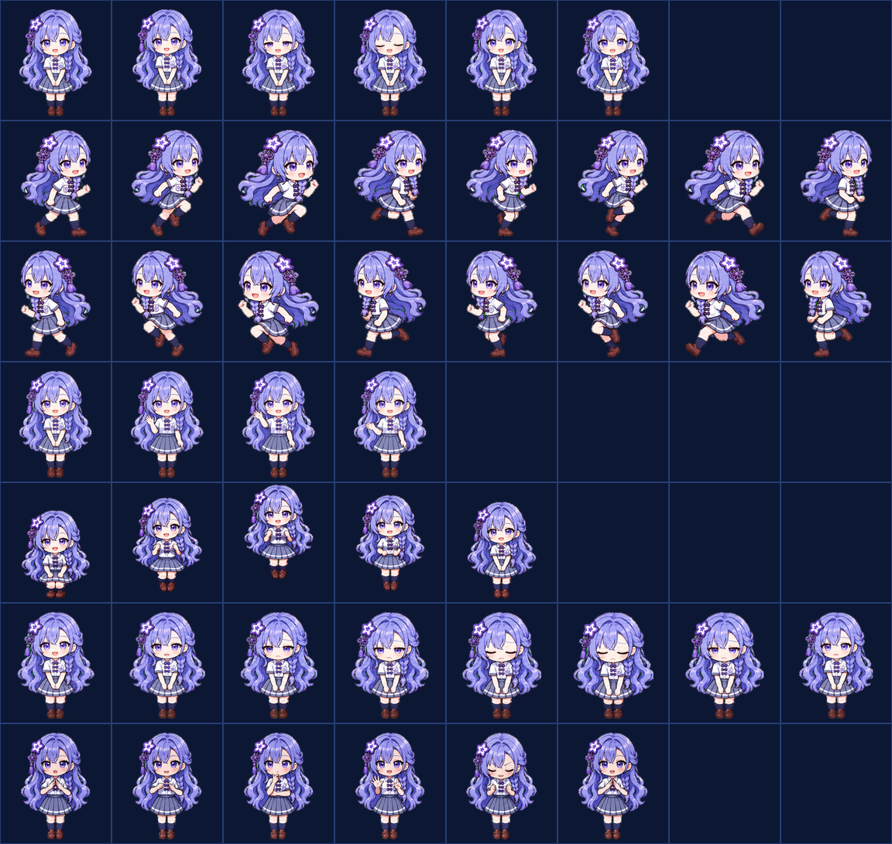

# 🐾 dsh-pet AI Sisters Pack · 七位 Q 版 AI 姐妹桌宠合集

<p align="center">
  
</p>

<p align="center">
  专为 <b>DeepSeek Harness Desktop</b> 桌面宠物插件 <a href="https://github.com/PC2005-cloud/dsh-pet"><b>dsh-pet (v0.4.3+)</b></a> 打造的开源自定义宠物包（Pet Pack）合集 ✨<br/>
  一次把 <b>Gemini酱、Kimi酱、GPT龙娘、Claude酱、Grok酱、千问酱、GLM酱</b> 请上桌面，与原版蓝毛小女仆（大肥鱼搭档）同屏陪伴写代码！
</p>

---

## ✨ 亮点特性

- **1:1 精致等比校准**：严格对齐 `dsh-pet` 原生 `640×360` 24fps `VP9 + Alpha (yuva420p)` 透明视频规格与脚底基线（`size: 462` 下与原版主角同高同地平线，不悬空、不突兀）。
- **全套物理与事件动作（每位姐妹 9 组透明动画，共 63 段 `.webm`）**：
  - `待机呼吸休闲` · `东张西望`（转身巡视） · `轻快小跑`（左右漫游，自动适配朝向镜像不倒退滑步）
  - `被鼠标拖拽悬空反馈`（提起晃脚 + 甩抛反弹物理） · `元气招手` · `欢呼蹦跳`
  - `认真施法推演`（思考 / 工具调用联动） · `委屈叹气`（报错 / 余额告急反馈） · `打盹小憩`（右键哄睡呼吸气泡循环）
- **专属人设台词 & 表情包贴纸**：每位姐妹均内置贴合性格的 `whisperPrompt`（碎碎念 / 持久记忆对话人设）、6 档会话工作状态气泡文案（思考 / 干活 / 阶段完成 / 等待拍板 / 大功告成 / 报错安慰）、哄睡赖床台词，以及 **4 张专属高清半身表情贴纸**（共 28 张 `memes`）。
- **开箱多开同屏排布**：默认全部开启 `display: "both"`（浏览器浮层 + 透明置顶桌面窗口双端显示），底部从右往左整齐错位列队，1080p / 2K / 4K 屏幕均不重叠，随时可拖去桌面任意角落。

---

## 🎀 登场姐妹图鉴（共 7 位）

| 头像 | ID | 名字 | 角色设定与外观特征 | 性格与气泡台词风格 |
| :---: | :---: | :---: | :--- | :--- |
|  | `gemini` | **Gemini酱** | 双子星粉金异瞳 · 猫耳魔法娘 · 彩虹四芒星发卡 | 灵动俏皮、古灵精怪又贴心，思考时星芒闪烁喵呜卖萌 ✨ |
|  | `kimi` | **Kimi酱** | 月之暗面银紫长发 · 弯月彩虹棱镜发饰 | 清冷温柔、书卷气十足，翻阅长卷陪你安静攻克难题 🌙 |
|  | `chatgpt` | **GPT龙娘** | 珍珠白发 · 弯弯白龙角 · 翡翠瞳白蔷薇发饰 | 温柔稳重、博学靠谱，完成任务会开心晃动小龙尾巴 🐉 |
|  | `claude` | **Claude酱** | 陶土暖橙卷发 · 暖橙小雏菊发夹文艺少女 | 细腻优雅、手冲咖啡与代码洁癖美学，治愈感拉满 🌼 |
|  | `grok` | **Grok酱** | 黑发白挑染 · 白色 `X` 发卡酷飒少女 | 机智犀利、爱玩梗微傲娇，关键时刻快刀斩乱麻极度护短 ⚡ |
|  | `qwen` | **千问酱** | 长春花紫侧麻花辫 · 四瓣星中国结流苏发饰 | 温婉灵秀、江南烟火气与桂花龙井茶香，手脚麻利贴心 🏮 |
|  | `glm` | **GLM酱** | 森林绿短发双细辫 · 青绿三角发卡眼镜学霸娘 | 严谨认真、推眼镜记实验笔记，被夸奖会害羞脸红 📗 |

<details>
<summary>🖼️ <b>点击展开查看 7 位姐妹完整 45 帧动作精灵图鉴（Sprite Sheets）</b></summary>
<br/>

| Gemini酱 (`gemini`) | Kimi酱 (`kimi`) |
| :---: | :---: |
|  |  |

| GPT龙娘 (`chatgpt`) | Claude酱 (`claude`) |
| :---: | :---: |
|  |  |

| Grok酱 (`grok`) | 千问酱 (`qwen`) |
| :---: | :---: |
|  |  |

| GLM酱 (`glm`) |
| :---: |
|  |

</details>

---

## 🚀 快速安装指南

> **前置条件**：已安装 DeepSeek Harness 及 [**dsh-pet**](https://github.com/PC2005-cloud/dsh-pet)（建议 `v0.4.3` 或更高版本）。

### 方法一：一键脚本安装（推荐，支持运行中自动热重载）

克隆仓库后运行对应系统的安装脚本，脚本会自动将宠物包复制到 `~/.dsh/dsh-pet/pet/`，并自动唤醒正在运行的 `dsh-pet` 立即刷新登场：

**Windows (PowerShell)：**

```powershell
git clone https://github.com/linyucion/dsh-pet-ai-sisters.git
cd dsh-pet-ai-sisters
powershell -ExecutionPolicy Bypass -File .\install.ps1
```

> 💡 只想召唤部分姐妹？可传 `-Pets` 参数：
> `powershell -ExecutionPolicy Bypass -File .\install.ps1 -Pets "gemini,kimi,chatgpt"`

**macOS / Linux (Bash)：**

```bash
git clone https://github.com/linyucion/dsh-pet-ai-sisters.git
cd dsh-pet-ai-sisters
bash ./install.sh
```

> 💡 按需选择安装：`bash ./install.sh "gemini,claude,qwen"`

---

### 方法二：零命令行手动拖入（Release 压缩包）

1. 前往 [**Releases 页面**](https://github.com/linyucion/dsh-pet-ai-sisters/releases) 下载最新 `dsh-pet-ai-sisters-v1.0.0.zip` 并解压。
2. 将解压后 `pet/` 文件夹内的文件直接复制进你的 `dsh-pet` 自定义宠物目录：
   - **Windows**：`C:\Users\<你的用户名>\.dsh\dsh-pet\pet\`
   - **macOS / Linux**：`~/.dsh/dsh-pet/pet/`
3. 在 DeepSeek Harness 的 **dsh-pet 设置面板**点击一次重载（或重启 DeepSeek Harness），7 位姐妹就会全部出现在桌面上啦！

安装后的目录结构示意（符合 `dsh-pet` 原生自定义种族规范）：

```text
~/.dsh/dsh-pet/pet/
├── gemini-config.json         # 种族与实例配置（人设、文案、权重、初始坐标）
├── gemini-avatar.png          # 设置面板与对话头像
├── gemini-animation/          # 9 段 640×360 VP9 透明通道动画 (.webm)
│   ├── 待机呼吸休闲.webm
│   ├── 东张西望.webm
│   ├── 轻快小跑.webm
│   ├── 被鼠标拖拽悬空反馈.webm
│   ├── 元气招手.webm
│   ├── 欢呼蹦跳.webm
│   ├── 认真施法推演.webm
│   ├── 委屈叹气.webm
│   └── 打盹小憩.webm
├── gemini-memes/              # 4 张专属对话表情包 (.png)
└── ...（其余 6 位姐妹同理）
```

---

## ⚙️ 个性化调整小贴士

你可以在 DeepSeek Harness 的 **dsh-pet Web 设置面板**中直接可视化开关每位姐妹、调整大小（`size`）、切换显示端（`桌面 + 浏览器` / `仅桌面` / `仅浏览器` / `隐藏`），也可以直接编辑 `~/.dsh/dsh-pet/pet/<id>-config.json`：

- **只保留喜欢的几位上桌**：将对应 `<id>-config.json` 中 `pets[0].display` 改为 `"none"`（或在 UI 面板一键关闭）。
- **调整体型大小**：修改 `pets[0].size`（默认 `462` 与原版蓝毛小女仆一致；想更袖珍可改 `360`~`400`）。
- **固定站位不乱跑**：将 `pets[0].fixedEnabled` 设为 `true`，或直接右键桌宠菜单切换。

---

## 🌏 English Quick Start

**dsh-pet AI Sisters Pack** adds **7 original animated chibi AI companions** (`gemini`, `kimi`, `chatgpt`, `claude`, `grok`, `qwen`, `glm`) as native drop-in pet packs for [**dsh-pet**](https://github.com/PC2005-cloud/dsh-pet) (`v0.4.3+`) in DeepSeek Harness Desktop.

- **Each sister includes**: 9 transparent `640×360` VP9-alpha `.webm` animations (idle, look-around, run, drag-dangle, wave, celebratory jump, magic working/thinking, sigh/error, and Zzz sleep loop), 1 crisp avatar, 4 reaction stickers, and tailored persona/status lines.
- **Install**:
  - **Windows**: `powershell -ExecutionPolicy Bypass -File .\install.ps1`
  - **macOS / Linux**: `bash ./install.sh`
  - **Manual**: Copy the contents of `pet/` into `~/.dsh/dsh-pet/pet/` and reload `dsh-pet`.

---

## 💖 致谢与署名声明（Credits & Attribution）

- **上游插件与规范致谢**：本项目基于 [**PC2005-cloud/dsh-pet**](https://github.com/PC2005-cloud/dsh-pet)（`v0.4.3`）的自定义宠物包（Pet Pack）扩展机制制作，衷心感谢原作者 **PC2005-cloud** 打造了如此细腻有趣的跨平台桌面宠物插件！本项目不包含、不分发 `dsh-pet` 原版内置动画与代码，并严格遵守上游项目公开渠道二创署名约定（<https://github.com/PC2005-cloud/dsh-pet>）。
- **角色形象说明**：本仓库中的七位 Q 版二次元拟人角色动画、贴纸与台词均为社区爱好者原创非商业同人创作（Fan-made Chibi Persona Tribute），仅用于桌面陪伴与技术交流，与各对应 AI 模型官方品牌无隶属或背书关系。
- **开源协议**：[MIT License](./LICENSE)。欢迎自由安装、魔改台词动作或提交 PR 分享更多可爱桌宠！
