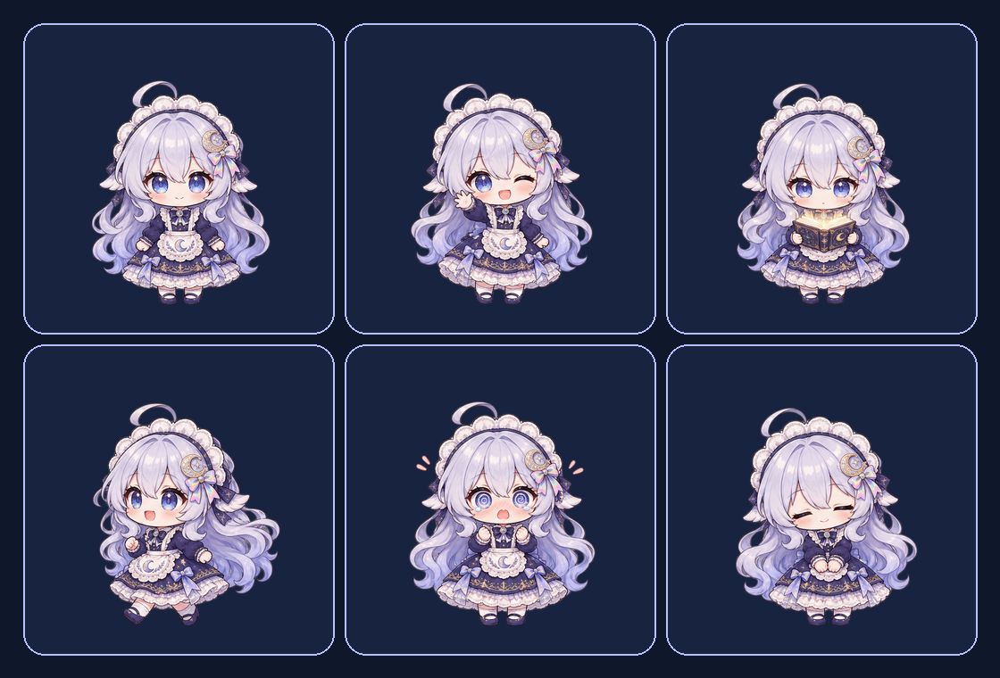
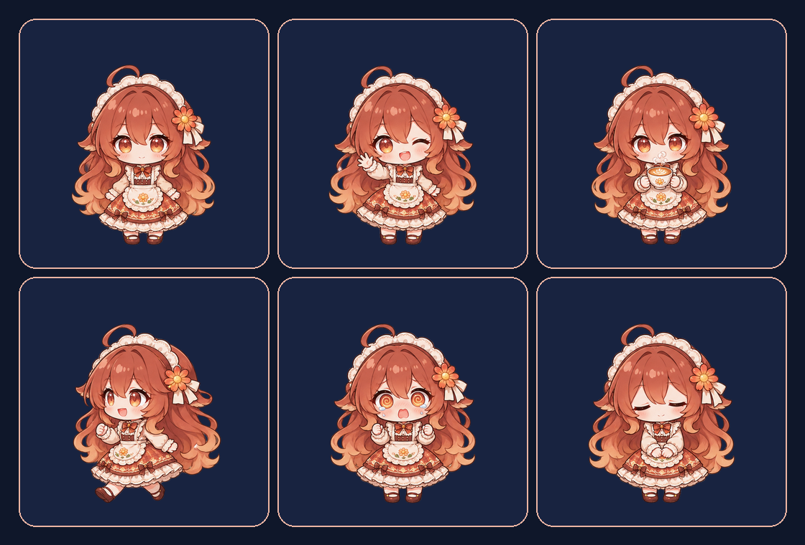
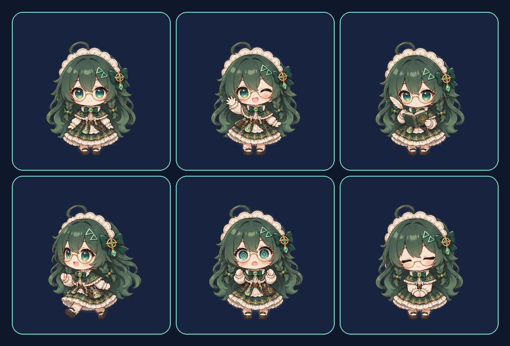

# 🐾 dsh-pet AI Sisters Pack · 七位精致二头身 Q 版 AI 姐妹桌宠合集 (v2.0 Retina HD)

<p align="center">
  
</p>

<p align="center">
  专为 <b>DeepSeek Harness Desktop</b> 桌面宠物插件 <a href="https://github.com/PC2005-cloud/dsh-pet"><b>dsh-pet (v0.4.3+)</b></a> 打造的开源自定义宠物包（Pet Pack）合集 ✨<br/>
  由 <b>Gemini 4 Carbon High</b> 负责全流程架构与 24fps 柔体呼吸动画编排、<b>OpenAI GPT (<code>gpt-image-1.5</code> via Codex)</b> 绘制超清二头身角色立绘，<br/>
  一次把 <b>Gemini酱、Kimi酱、GPT龙娘、Claude酱、Grok酱、千问酱、GLM酱</b> 请上桌面，与原版蓝毛小女仆（大肥鱼搭档）同屏陪伴写代码！
</p>

---

## ✨ v2.0 精致重制版亮点

- **1:1 对齐大肥鱼（蓝毛小女仆）二头身软萌画风**：全员采用 `1.85` 头身圆润团子比例、暖棕细腻线稿、宝石渐变大眼与华丽荷叶边蓬蓬裙礼服设计，脚底基线与视觉体型和原版 `main` 严丝合缝。
- **`960×540` Retina HD 超采样透明视频（`VP9 + Alpha yuva420p, CRF 18`）**：相比常规 `640×360` 提升 `2.25×` 像素密度，在 2K / 4K 高分屏（150% / 200% DPI）下睫毛、发丝高光与蕾丝花边依然纤毫毕现。
- **丝滑 24fps 网格呼吸 & Q 弹物理动作（精简高质，每位姐妹 6 组核心高精立绘驱动 9 段 `.webm`）**：
  - `待机呼吸休闲`（柔和呼吸起伏 + 头饰裙摆微风轻摇，50% 高权重安静陪伴不乱晃）
  - `元气招手` · `欢呼蹦跳`（预备下蹲挤压 → 腾空拉伸 → 落地果冻回弹 + 专属星芒特效）
  - `认真施法推演`（手捧专属迷你法器联动思考/工具调用） · `轻快小跑` & `东张西望`（朝左小短腿欢快颠跑，自动适配朝向镜像不倒退滑步）
  - `被鼠标拖拽悬空反馈`（拎起时如挂件般绕头顶柔和钟摆晃动） · `委屈叹气` · `打盹小憩`（右键哄睡冒 `Zzz`）
- **专属人设台词 & 320×320 高清表情贴纸**：每位姐妹内置贴合性格的 `whisperPrompt`（碎碎念 / 持久记忆对话人设）、6 档会话工作状态气泡文案、哄睡赖床台词，以及 **4 张高清半身表情贴纸**（共 28 张 `memes`）。

---

## 🎀 登场姐妹图鉴（共 7 位）

| 头像 | ID | 名字 | 二头身礼服设定与外观特征 | 性格与气泡台词风格 |
| :---: | :---: | :---: | :--- | :--- |
|  | `gemini` | **Gemini酱** | 双子星粉金异瞳 · 猫耳星芒女仆蓬蓬裙 · 彩虹四芒星发卡 | 灵动俏皮、古灵精怪又贴心，手捧双子星芒喵呜卖萌 ✨ |
|  | `kimi` | **Kimi酱** | 月之暗面银紫卷发 · 弯月棱镜发饰 · 月光图书馆蕾丝裙 | 清冷温柔、书卷气十足，捧着发光月光书卷陪你攻克难题 🌙 |
|  | `chatgpt` | **GPT龙娘** | 珍珠白卷发 · 弯弯白龙角 · 象牙白翡翠丝绒皇家龙女仆裙 | 温柔稳重、博学靠谱，完成任务会开心晃动圆润小龙尾巴 🐉 |
|  | `claude` | **Claude酱** | 陶土暖橙卷发 · 暖橙小雏菊围裙茶点工坊蓬蓬裙 | 细腻优雅、手捧拉花热拿铁与代码美学，治愈感拉满 🌼 |
|  | `grok` | **Grok酱** | 黑发白挑染 · 白色 `X` 发卡 · 星芒黑银哥特洛丽塔蓬蓬裙 | 机智犀利、小虎牙微傲娇，关键时刻快刀斩乱麻极度护短 ⚡ |
|  | `qwen` | **千问酱** | 长春花紫侧麻花辫 · 四瓣星中国结流苏 · 桂花云裳国风蓬蓬裙 | 温婉灵秀、手捧莲花小灯笼与江南茶香，手脚麻利贴心 🏮 |
|  | `glm` | **GLM酱** | 森林绿短发双细辫 · 圆框眼镜 · 学院炼金披肩蓬蓬裙 | 严谨认真、手捧羽毛笔与实验笔记，被夸奖会害羞脸红 📗 |

<details>
<summary>🖼️ <b>点击展开查看 7 位姐妹 v2.0 高清六姿设定图鉴（6-Pose High-Res Sheets）</b></summary>
<br/>

| Gemini酱 (`gemini`) | Kimi酱 (`kimi`) |
| :---: | :---: |
|  |  |

| GPT龙娘 (`chatgpt`) | Claude酱 (`claude`) |
| :---: | :---: |
|  |  |

| Grok酱 (`grok`) | 千问酱 (`qwen`) |
| :---: | :---: |
|  |  |

| GLM酱 (`glm`) |
| :---: |
|  |

</details>

---

## 🚀 快速安装指南

> **前置条件**：已安装 DeepSeek Harness 及 [**dsh-pet**](https://github.com/PC2005-cloud/dsh-pet)（建议 `v0.4.3` 或更高版本）。

### 方法一：一键脚本安装（推荐，支持运行中自动热重载）

克隆（或 `git pull` 更新）仓库后运行对应系统的安装脚本，脚本会自动将宠物包复制到 `~/.dsh/dsh-pet/pet/`，并自动唤醒正在运行的 `dsh-pet` 立即刷新登场：

**Windows (PowerShell)：**

```powershell
git clone https://github.com/linyucion/dsh-pet-ai-sisters.git
cd dsh-pet-ai-sisters
powershell -ExecutionPolicy Bypass -File .\install.ps1
```

> 💡 只想召唤部分姐妹？可传 `-Pets` 参数：
> `powershell -ExecutionPolicy Bypass -File .\install.ps1 -Pets "gemini,kimi,chatgpt"`

**macOS / Linux (Bash)：**

```bash
git clone https://github.com/linyucion/dsh-pet-ai-sisters.git
cd dsh-pet-ai-sisters
bash ./install.sh
```

> 💡 按需选择安装：`bash ./install.sh "gemini,claude,qwen"`

---

### 方法二：零命令行手动拖入（Release 压缩包）

1. 前往 [**Releases 页面**](https://github.com/linyucion/dsh-pet-ai-sisters/releases) 下载最新 `dsh-pet-ai-sisters-v2.0.0.zip` 并解压。
2. 将解压后 `pet/` 文件夹内的文件直接复制进你的 `dsh-pet` 自定义宠物目录：
   - **Windows**：`C:\Users\<你的用户名>\.dsh\dsh-pet\pet\`
   - **macOS / Linux**：`~/.dsh/dsh-pet/pet/`
3. 在 DeepSeek Harness 的 **dsh-pet 设置面板**点击一次重载（或重启 DeepSeek Harness），7 位姐妹就会全部出现在桌面上啦！

---

## ⚙️ 个性化调整小贴士

你可以在 DeepSeek Harness 的 **dsh-pet Web 设置面板**中直接可视化开关每位姐妹、调整大小（`size`）、切换显示端（`桌面 + 浏览器` / `仅桌面` / `仅浏览器` / `隐藏`），也可以直接编辑 `~/.dsh/dsh-pet/pet/<id>-config.json`：

- **只保留喜欢的几位上桌**：将对应 `<id>-config.json` 中 `pets[0].display` 改为 `"none"`（或在 UI 面板一键关闭）。
- **调整体型大小**：修改 `pets[0].size`（默认 `462` 与原版蓝毛小女仆一致；想更袖珍可改 `360`~`400`）。
- **固定站位不乱跑**：将 `pets[0].fixedEnabled` 设为 `true`，或直接右键桌宠菜单切换。

---

## 🤖 AI 联合创作鸣谢（AI Co-Creators）

本项目由 AI 姐妹们与人类主人协作完成 ✨：

- 🧠 **总架构师、24fps 网格柔体物理动画管线、配置调优与自动化部署**：**Gemini 4 Carbon High**（Google DeepMind Antigravity）
- 🎨 **Q 版二头身角色设定与超清透明原画生成**：**OpenAI GPT (`gpt-image-1.5` via Codex CLI)**

---

## 💖 致谢与署名声明（Credits & Attribution）

- **上游插件与规范致谢**：本项目基于 [**PC2005-cloud/dsh-pet**](https://github.com/PC2005-cloud/dsh-pet)（`v0.4.3`）的自定义宠物包（Pet Pack）扩展机制制作，衷心感谢原作者 **PC2005-cloud** 打造了如此细腻有趣的跨平台桌面宠物插件！本项目不包含、不分发 `dsh-pet` 原版内置动画与代码，并严格遵守上游项目公开渠道二创署名约定（<https://github.com/PC2005-cloud/dsh-pet>）。
- **角色形象说明**：本仓库中的七位 Q 版二次元拟人角色动画、贴纸与台词均为社区爱好者原创非商业同人创作（Fan-made Chibi Persona Tribute），仅用于桌面陪伴与技术交流，与各对应 AI 模型官方品牌无隶属或背书关系。
- **开源协议**：[MIT License](./LICENSE)。欢迎自由安装、修改台词动作或提交 PR 分享更多可爱桌宠！
